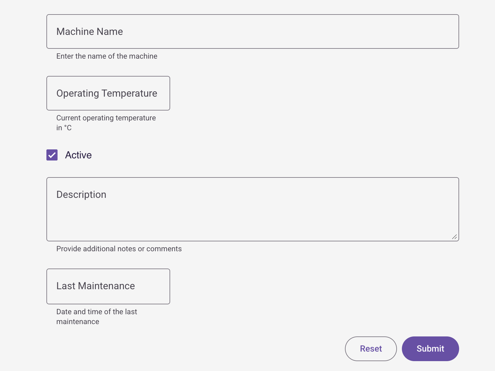

# widget-form

A Lit 3.x web component for creating dynamic forms with configurable fields. Part of the IronFlock widget ecosystem.



## Installation

```bash
npm i @ironflock/widget-form
```

## Usage

```html
<script type="module">
    import '@ironflock/widget-form'
</script>

<widget-form-1.0.9></widget-form-1.0.9>
```

> **Note:** The version number is part of the custom element tag name.

## Properties

| Property    | Type        | Description                   |
| ----------- | ----------- | ----------------------------- |
| `inputData` | `FormConfiguration` | Form configuration and fields |
| `theme`     | `Theme`     | Theme object for styling      |

## Events

| Event              | Detail                                   | Description                                                      |
| ------------------ | ---------------------------------------- | ---------------------------------------------------------------- |
| `data-submit`      | Array of field/value mappings            | Fired when the form is submitted                                 |
| `file-data-submit` | `{ items, waitUntil }` (see File Fields) | Fired instead of `data-submit` when the save includes a new file |

## Configuration

The form is configured via the `inputData` property:

```ts
interface FormConfiguration {
    title?: string
    subTitle?: string
    formButton?: boolean // Show button to open form dialog
    formDialogSize?: FormDialogSize // Minimum size of that dialog
    formFields?: FormField[]
}
```

### Dialog Size

With `formButton: true` the form opens in a dialog that is 480px wide (narrower on small screens) and as tall as its fields, up to 80% of the window height. `formDialogSize` sets the dialog's minimum width and height:

```ts
interface FormDialogSize {
    minWidth?: string // e.g. '800px', '60%', '50vw'
    minHeight?: string // e.g. '600px', '70%', '90vh'
}
```

Each value is a number with an optional unit: `px` (assumed when there is none), `%` or `vw`/`vh` for a share of the window, `rem` or `em`. Empty keeps the default. A value replaces Material's own 280×140px minimum and is capped at the window less 24px on each side, so the dialog and its Submit button always stay on screen; a form taller than that scrolls inside the dialog. On an ordinary window a value below the default size therefore changes nothing, while on a window narrower than 328px (or a very short one) any value, even a large one, lets the dialog shrink a little below Material's minimum to keep those margins. Anything else, such as `auto`, `calc()` or a negative number, is ignored with a console warning.

### Dialog Colours

The dialog and its dropdown menus take the tile's colour as it is displayed (the tile over the dashboard background), so the text colour reads on them. On a dark tile they are lightened one step and the backdrop behind the dialog darkens more (60% instead of 32%), so the dialog stands out from the page; on a light tile they keep the tile's colour.

### Field Types

Each form field supports the following types:

| Type          | Description                    |
| ------------- | ------------------------------ |
| `textfield`   | Single-line text input         |
| `numberfield` | Numeric input with min/max     |
| `checkbox`    | Boolean checkbox               |
| `textarea`    | Multi-line text input          |
| `dropdown`    | Select from predefined options |
| `datetime`    | Date/time picker               |
| `file`        | Upload one file (FleetFiles)   |
| `secret`      | Masked password or token       |

### Field Configuration

```ts
interface FormField {
    label: string
    type: 'dropdown' | 'textfield' | 'numberfield' | 'checkbox' | 'textarea' | 'datetime' | 'file' | 'secret'
    hiddenField?: boolean // Hide field but still submit value
    required?: boolean // Field must be filled
    description?: string // Hint text shown below field
    targetColumn?: TargetColumn // Database column mapping
    preFilledValue?: string // For a file: the record's current key; not for a secret
    defaultValue?: string
    min?: number // For numberfield
    max?: number // For numberfield
    validation?: string // Regex for textfield and secret
    values?: DropdownValue[] // For dropdown type
    fileNamespace?: string // For file: the app's FleetFiles namespace (required)
    acceptedFileTypes?: string // For file: 'application/pdf, image/*'
    maxFileSizeMB?: number // For file: 1 MB = 1,048,576 bytes
    fileNameColumn?: TargetColumn // For file: gets the original file name
    fileSizeColumn?: TargetColumn // For file: gets the size in bytes
    fileTypeColumn?: TargetColumn // For file: gets the content type
    fileUrlColumn?: TargetColumn // For file: gets the file's permanent URL (Studio writes it)
}
```

### File Fields

A `file` field stores one file in the app's file storage (FleetFiles) and writes the stored object's key into its target column, a string column, in the same save as the rest of the form.

- The field is a drop zone: click it to pick a file or drop one on it. It shows the file's name and size, and a button to remove it. Reset clears it.
- `acceptedFileTypes` (MIME types, `type/*` allowed) filters the picker and refuses other files on the spot; so does `maxFileSizeMB`. The browser's type is used when it fits, otherwise the one the file's extension stands for, so a CSV that Windows calls `application/vnd.ms-excel` is still `text/csv`.
- `fileNamespace` names a namespace from the `files` section of the app's data template. Its own `contentTypes` and `maxObjectBytes` apply as well. Files up to 6 MB upload on every installation; larger ones only where the platform can issue upload links (the cloud, not an appliance).
- `fileUrlColumn` gets the stored file's permanent platform URL, so other widgets can show or link the file: an embed of a PDF, an image. Opening it needs a signed-in IronFlock session. Studio builds it after the upload; it stays empty where the installation serves no file links, and with a Studio version that does not write it.
- In an edit form, bind `preFilledValue` to the record's key column. The field then shows that file (the key's last segment is the file name), and a save without a new file writes the key back unchanged. Without a pre-filled key and without a new file, the column is left out of the row, never set to null, so a table with entity keys keeps its previous value. The name, size, type and URL columns are only written with a new file. A file field hidden by Conditional Display submits null, like every other field.

The widget never uploads anything itself. A save with a new file dispatches `file-data-submit` instead of `data-submit`:

```ts
detail: {
    items: Array<
        | { swarm_app_databackend_key, table_name, column_name, value } // as in data-submit
        | {
              swarm_app_databackend_key, table_name, column_name, file: File, namespace: string, contentType: string
              urlColumn?: { swarm_app_databackend_key, table_name, column_name } // the field's fileUrlColumn
          }
    >
    waitUntil(outcome: Promise<unknown>): void
}
```

The host claims the event by calling `waitUntil()` while it is dispatched. It uploads each `file` under a key of its choosing, puts the key in as that item's value, writes the object's permanent URL into the item's `urlColumn` (null where it cannot build one), and writes the rows only when every upload succeeded. A null item for the URL column comes ahead of the file item, and a later item for the same column wins: a host that writes no URL leaves the column empty instead of keeping another file's URL. The form shows "Saving…" until the promise settles. If it resolves, the form resets and the dialog closes. If it rejects, the form keeps its values and shows the error's message. A host that does not know the event (Studio before file support) never claims it, and the form says that it cannot upload and saves nothing, rather than sending a `File` through `data-submit`, which would write garbage into the column.

### Secret Fields

A `secret` field takes a password, token or key without showing it: the input is masked, and an eye button shows what was typed. It is write-only: a saved secret never comes back to the widget, so the field has no pre-filled value and always starts empty.

- Point it at a string column declared `secret: true` in the app's data template. FleetDB encrypts that column and never returns the value to a board (Studio shows `••••••••`); only the app's own containers can read it, with the SDK's `revealSecrets()`. Any other column stores the value as plain text.
- Left empty, the field leaves its column out of the save. A table that keeps the latest row per entity (`maintainLatestFlagFor`) then carries the stored secret over; any other table stores NULL. The widget does not send FleetDB's keep sentinel (`__secret__`): on a table without entity keys FleetDB rejects the whole row, and Studio's publish does not report that, and a column that is not `secret: true` would store it literally.
- `required` means a new value must be typed on every save, so leave it off in a form that edits existing records. `validation` checks a newly typed value, such as `^.{12,}$` for at least 12 characters.
- The value is sent exactly as typed, spaces included. The browser is told it is a new password (`autocomplete="new-password"`), so it does not fill in the viewer's saved login.

## Development

```bash
# Start dev server
npm run start

# Build for production
npm run build

# Generate types from schema
npm run types

# Build, bump version, and publish
npm run release
```

## License

MIT
